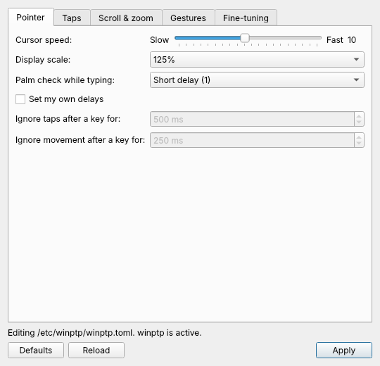
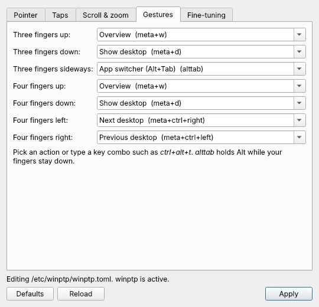
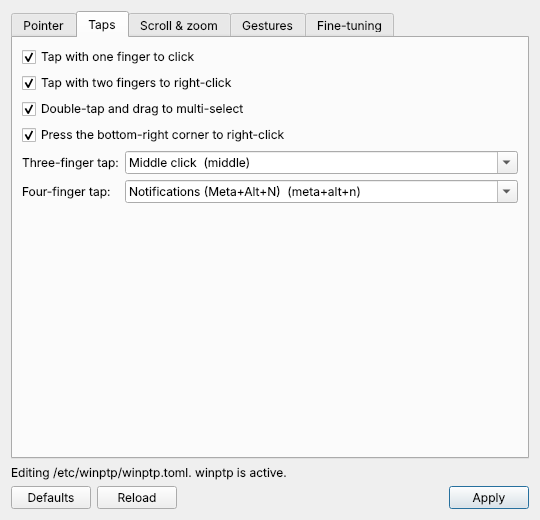
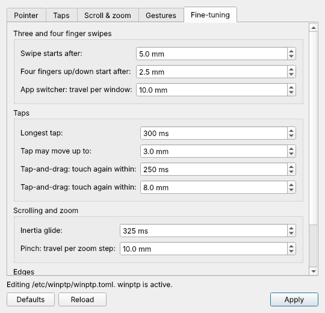

# winptp: Windows precision touchpad feel for Kubuntu

winptp is a small userspace touchpad driver for KDE Plasma. It makes a
Linux touchpad behave like a Windows 10 precision touchpad: the same
pointer speed curve, tap timing, palm check, two-finger scrolling with
inertia, pinch zoom, and 3/4-finger gestures.

It reads the touchpad's multitouch stream, runs it through a Windows-style
gesture engine, and sends the result to KWin through virtual devices (a
pointer, a touchpad for native pinch, and a keyboard for gesture shortcuts).
Stopping winptp gives the touchpad straight back to libinput. A small
[settings app](#settings-app) lets you change everything without editing
files.

> **Status:** works well on the author's laptop and has been tested only
> there: Lenovo IdeaPad Flex-14API (81SS) with a Synaptics 06CB:7F28 I2C
> touchpad, Kubuntu 26.10, Plasma 6.7 on Wayland. Other precision
> touchpads should work, since winptp reads the size from the kernel, but
> reports and fixes are very welcome.

## What it does

| Windows behaviour | winptp |
|---|---|
| Ballistic pointer acceleration (Windows curve, CursorSpeed, display DPI) | Same 4-segment curve and gain |
| Tap = lift within 300 ms and under 3 mm | Same |
| Two-finger tap = right click | Same |
| Three-finger tap | Middle click |
| Four-finger tap = Action Center | Meta+Alt+N (bind it to Plasma notifications, see below) |
| Tap-and-drag | Same, with a shorter 250 ms / 8 mm window to avoid accidental drags |
| Right-click zone, two-finger click = right click, resting thumb ignored | Same |
| No cursor drift while clicking or tapping | Same |
| Palm check while typing (levels 0-4) | Same levels, level 1 by default |
| Two-finger scroll with direction lock, notch-per-distance by speed | Same, as hi-res wheel events |
| Scroll inertia | Exponential decay, tuned by hand |
| Pinch zoom | Native smooth pinch in apps |
| 3 fingers up / down / sideways = Task View / Desktop / app switcher | Overview / Show Desktop / Alt+Tab |
| 4 fingers sideways = switch virtual desktop | Meta+Ctrl+Left/Right |

## Install

You need Kubuntu (or another Plasma 6 distro with apt) and Python 3.11+.

**Option 1: .deb package.** Download `winptp_<version>_all.deb` from the
[Releases](../../releases) page, then:

    sudo apt install ./winptp_*_all.deb

**Option 2: from source.**

    git clone https://github.com/QuantumPixelNomad/Linux-precision-touchpad-drivers
    cd Linux-precision-touchpad-drivers
    ./install.sh

Both install the code to `/opt/winptp`, the settings to
`/etc/winptp/winptp.toml`, the [settings app](#settings-app), and start
`winptp.service`. Log out and back in
once so KWin picks up the flat acceleration for the virtual pointer.

**Try it without installing:** `sudo python3 -m winptp --dry-run` prints
what it would do without taking over the touchpad (needs `python3-evdev`).

### Four-finger tap shortcut

The four-finger tap sends Meta+Alt+N. In System Settings > Keyboard >
Shortcuts, find the Notifications widget's "Activate" entry and set it to
Meta+Alt+N. Or set `tap_four` to any other key combo.

## Settings app

winptp comes with a small settings window. Open **Touchpad (winptp)** from
the app launcher, or run `winptp-settings` in a terminal.

  
  

| Tab | What you can change |
|---|---|
| **Pointer** | Cursor speed (1-20, like the Windows slider), display scale, and how long the touchpad ignores you after you type. Pick a level, or tick *Set my own delays* to set the tap and movement delays in milliseconds. |
| **Taps** | Tap to click, two-finger tap for right click, tap-and-drag, the bottom-right right-click corner, and what three- and four-finger taps do. |
| **Scroll & zoom** | Natural scrolling, scroll inertia, pinch to zoom. |
| **Gestures** | What each three- and four-finger swipe does. Pick a preset (Overview, Show desktop, app switcher, next/previous desktop, notifications) or type any key combo such as `ctrl+alt+t`. |
| **Fine-tuning** | Distances and timings: how far to swipe before a gesture fires, how far to move per window in the three-finger app switcher, tap and tap-and-drag limits, how long scrolling glides, and the edge zones. |

  
  

**Apply** asks for your password once, saves `/etc/winptp/winptp.toml`
and restarts winptp, so changes take effect straight away. The previous
file is kept as `/etc/winptp/winptp.toml.bak`. **Defaults** fills in the
default values (press Apply to keep them), and **Reload** throws away
unsaved changes. Comments in the file and settings the window doesn't show
are left alone. A key combo winptp doesn't know turns red and isn't saved,
so a typo can't break the touchpad.

The app needs PySide6 (`sudo apt install python3-pyside6.qtwidgets`) or
PyQt6. Both install methods above pull it in.

### Editing the file by hand

You can also edit `/etc/winptp/winptp.toml` by hand, then run
`sudo systemctl restart winptp`. Useful ones:

| Setting | What it does |
|---|---|
| `cursor_speed` | Pointer speed 1-20, like the Windows slider (default 10) |
| `screen_dpi` | 96 times your display scale, e.g. 120 for 125% |
| `natural_scroll` | Scroll direction |
| `aap_threshold` | Palm check while typing, 0 (off) to 4 (strictest) |
| `typing_tap_block_ms`, `typing_move_block_ms` | Your own palm check delays in ms (-1 = use `aap_threshold`) |
| `alt_tab_step_mm` | Finger travel per window in the three-finger app switcher |
| `gesture_start_mm` | Finger travel before a three/four-finger swipe fires |
| `tap_three`, `tap_four` | `"middle"` or a key combo like `"meta+alt+n"` |
| `swipe3_*`, `swipe4_*` | Key combos for each swipe; `"alttab"` holds Alt for the switcher |

While winptp runs, the Touchpad page in System Settings has no effect,
because winptp owns the touchpad.

## Uninstall

    sudo apt remove winptp      # if you used the .deb
    ./uninstall.sh              # if you used install.sh

The touchpad goes straight back to plain libinput. Your settings in
`/etc/winptp` are kept unless you `sudo apt purge winptp`.

## Development

    python3 -m unittest discover tests   # engine tests, no hardware needed
    ./build-deb.sh                       # builds dist/winptp_<version>_all.deb
    sudo python3 -m winptp -v            # run in the foreground with logging
    python3 -m winptp.settings packaging/winptp.toml   # settings window on a copy

`winptp/engine.py` is a pure state machine (touch frames in, actions out),
so most behaviour can be tested without a touchpad. `winptp/daemon.py`
does the evdev/uinput plumbing. `winptp/settings.py` is the Qt settings
app; it hands the new file to the `winptp-apply` helper through pkexec.

How the project came about: [docs/HOW-IT-WAS-MADE.md](docs/HOW-IT-WAS-MADE.md).

## License

GPL-3.0. See [LICENSE](LICENSE). winptp is an independent project, not
affiliated with or endorsed by Microsoft. It contains no Microsoft code.
